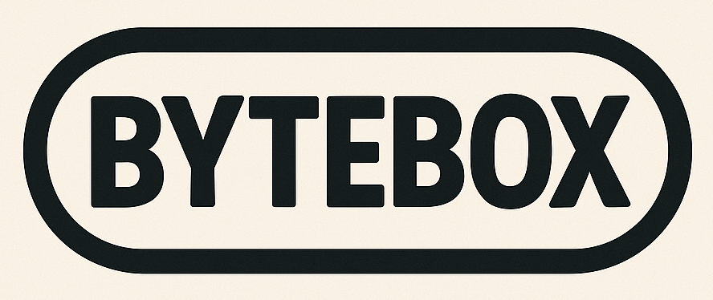

# ByteBox



[English](README.md) | **Español** | [Português](README.pt.md)

[](LICENSE)
[](https://github.com/danielspk/bytebox-wasm/tags)
[](https://github.com/danielspk/bytebox-wasm/tree/main/demos/templates)
[](https://webassembly.org/)

**ByteBox** es un proyecto basado en la idea de una consola de fantasía diseñada para crear videojuegos "old school".

El proyecto busca inspirar la creatividad mediante la interacción con "hardware" _(virtualizado)_ a través de comunicación mapeada en memoria.

## Directorios

- **console**: contiene el runtime WASM. Es la "consola" que se ejecuta en un navegador web.
- **demos**: contiene juegos de ejemplo y templates de distintos lenguajes para compilar a **WASM**.
- **src**: opcionalmente contiene el código fuente de un juego.

## Primeros pasos

Para probar la consola por primera vez no necesitás compilar nada: copiá el `game.wasm` de uno de los juegos de ejemplo de `demos/games/` a la carpeta `console/assets/wasm/`, o arrastrá y soltá un juego sobre la ventana del navegador para cargarlo al instante.

## Plataforma

La idea detrás de usar **WASM** como arquitectura objetivo es que permite emplear distintos lenguajes de programación para lograr un objetivo común: _programar y divertirse_.

Los desarrolladores pueden crear juegos usando lenguajes de más de 50 años de antigüedad como _C_, u otros más modernos como _Rust_.

> La compilación debe usar **WASM** puro, sin dependencias de **WASI**.

### Runtime

El runtime usa _JavaScript_ vanilla en menos de 1000 líneas de código. El objetivo no es la extensibilidad ni la modularidad, sino una implementación simple y minimalista, sin overhead.

También hay disponible un visor de memoria igualmente simple. Los usuarios pueden acceder a él con la tecla `F8`.

### Ejemplos

#### Juegos

Junto con el proyecto se incluyen algunos juegos prototipo simples ya compilados.

#### Templates

Además, el proyecto provee varios ejemplos de template simples en distintos lenguajes de programación. Adicionalmente, los desarrolladores pueden usar cualquier lenguaje que compile a wasm estándar _(sin runtimes)_.

Para ejecutar cualquiera de estos ejemplos, copiá el contenido del template de ejemplo dentro de la carpeta `src/` y ejecutá el comando de compilación correspondiente al lenguaje de programación usado _(ver Comandos Útiles)_.

## Características/Limitaciones

- Arquitectura de 8 bits - _little endian_.
- 64KB de memoria.
- Display de 160x120 píxeles.
- Paleta RGB de 16 colores.
- Framebuffer lineal (4 bits por píxel).
- 2 controles (pads) con 6 botones cada uno.
- 4 canales de efectos (SFX) + 8 canales de melodía.
- Los juegos compilados no deberían superar los 50KB.
- Sin funciones predefinidas para reproducir sonidos o dibujar sprites. Solo están disponibles operaciones de lectura/escritura en memoria.
- Sin botón de reset.

### Notas sobre Decisiones de Diseño

> Sobre la limitación de tamaño del juego: 50KB puede parecer poco, pero estas restricciones habilitan una creatividad significativa. La limitación no es bloqueante, ya que los desarrolladores jóvenes podrían beneficiarse al habilitar opciones de debugging que rápidamente exceden el límite deseado. Sin embargo, los juegos que superan este tamaño muestran un indicador rojo en pantalla 🫣.

> Sobre la RAM del cartucho: el límite de 50KB es del `.wasm` compilado, no de la memoria que el juego usa en ejecución. Esa memoria vive fuera del mapa de 64KB de la consola, no tiene límite y la consola no la mide.

> Sobre la ausencia de funciones gráficas: implementar movimiento de sprites personalizado, gravedad, procedimientos de parallax y características similares brinda una excelente oportunidad de aprendizaje 🧠.

> Sobre la resolución de pantalla y los colores: buscamos una resolución con la clásica relación de aspecto 4:3 y medidas similares a las de la Game Boy. Asimismo, se pueden representar 16 colores personalizables y la consola usa un framebuffer en lugar de un clásico sistema de tiles y atributos.

> Sobre los controles (pads): tener solo dos botones principales es una de las limitaciones más importantes y deliberadas. Quedan algunas dudas sobre esta decisión, pero afortunadamente hay 2 bits disponibles por si en el futuro fuera necesario reconsiderarla.

> Sobre reservar espacio para la RAM y el Stack: responde a un posible uso dual con assembler _(MOS 6502, Zilog 80, etc)_.

## Funciones

La _API_ de interacción con **WASM** es mínima y consiste en 2 funciones exportables y 4 importables.

### Exportables

- `init()`: Se ejecuta una vez cuando el juego inicia. Esta función típicamente inicializa valores y configuraciones del juego. No tiene argumentos de entrada ni valores de retorno. Su uso es opcional y su implementación/exportación no es obligatoria.
- `update()`: Se ejecuta 60 veces por segundo dentro del game loop. No tiene argumentos de entrada ni valores de retorno. Su implementación y exportación es obligatoria.

### Importables

- `peek(addr) -> value`: Obtiene el valor de una dirección de memoria.
- `poke(addr, value)`: Establece un valor en una dirección de memoria.
- `spoke(start_addr, length, data)`: _super poke_, escribe múltiples bytes en memoria en una sola llamada.
- `trace(str, len)`: Emite un mensaje de log. Como WASM comparte memoria para trabajar con tipos de datos complejos _(como strings)_, se debe especificar la longitud del mensaje.

## Mapa de Memoria

El mapa de memoria de **ByteBox** consiste en una memoria lineal de 64KB. Opera sobre una arquitectura de 8 bits, por lo que cada dirección de memoria puede almacenar un byte. El direccionamiento de memoria es de 16 bits (0x0000 a 0xFFFF).

### Detalle

| Rango | Tamaño | Descripción |
|-------|--------|-------------|
| `0x0000-0x003F` | 64 bytes | Reservado para vectores de interrupción Z80/8080 (uso futuro) |
| `0x0040` | 1 byte | Flags de sistema |
| `0x0041` | 1 byte | Semilla para números aleatorios |
| `0x0042-0x0047` | 6 bytes | Reservado (uso futuro) |
| `0x0048-0x005F` | 24 bytes | Nombre del juego |
| `0x0060-0x00FF` | 160 bytes | Reservado (uso futuro) |
| `0x0100-0x01FF` | 256 bytes | Reservado para Stack (uso futuro) |
| `0x0200-0xC9FF` | 51.200 bytes | ROM del juego |
| `0xCA00-0xCFFF` | 1.536 bytes | Reservado (uso futuro) |
| `0xD000-0xD3FF` | 1.024 bytes | RAM de escritura |
| `0xD400-0xD7FF` | 1.024 bytes | Reservado para RAM (uso futuro) |
| `0xD800-0xFD7F` | 9.600 bytes | Framebuffer de video |
| `0xFD80-0xFEFF` | 384 bytes | Reservado (uso futuro) |
| `0xFF00-0xFF2F` | 48 bytes | Paleta de colores |
| `0xFF30-0xFF3F` | 16 bytes | Reservado (uso futuro) |
| `0xFF40-0xFF41` | 2 bytes | Controles (pads) |
| `0xFF42-0xFF5E` | 29 bytes | Reservado (uso futuro) |
| `0xFF5F` | 1 byte | Estado de los canales SFX |
| `0xFF60-0xFF6F` | 16 bytes | Canales SFX |
| `0xFF70-0xFF7E` | 15 bytes | Reservado (uso futuro) |
| `0xFF7F` | 1 byte | Atributos de melodía |
| `0xFF80-0xFFBF` | 64 bytes | Ring buffer de melodía |
| `0xFFC0-0xFFC1` | 2 bytes | Punteros de melodía |
| `0xFFC2-0xFFF7` | 54 bytes | Reservado (uso futuro) |
| `0xFFF8-0xFFFF` | 8 bytes | Reservado para vectores de interrupción 6502 (uso futuro) |

> El diseño evita deliberadamente compartir memoria directamente con **WASM** en favor de las funciones peek/poke. Esta capa de abstracción provee mejor encapsulamiento, permite el logging y la validación de accesos a memoria, previene posibles buffer overflows y le da al runtime más flexibilidad en la gestión de memoria sin exponer detalles de implementación de bajo nivel al código del juego.

> No obstante, como en todo sistema de bajo nivel, el uso correcto de la memoria es responsabilidad del programador: la consola verifica que las direcciones estén dentro de los 64KB, pero **no impide de ninguna manera** el acceso a una dirección de solo lectura. Escribir en regiones de solo lectura _(pads, estado de SFX, cola de melodía, ROM, etc.)_ está permitido y puede producir comportamiento inesperado.

### Flags de Sistema

La dirección `0x0040` _(1 byte)_ establece los flags de sistema. Representación de bits:

```txt
7 6 5 4 3 2 1 0
│ │ │ │ │ │ │ │
│ │ │ │ │ │ │ └ HALT/RESUME
│ │ │ │ │ │ └── DUMP WRAM
└─└─└─└─└─└──── sin usar
```

- **Halt/Resume**: cuando el bit está en 1, la ejecución del game loop se detiene _(el renderizado continúa)_. Cuando el bit vale 0, el game loop sigue ejecutándose.
- **Dump WRAM**: cuando el bit está en 1, la WRAM se vuelca al cartucho _(en realidad se usa local storage)_. Cuando el volcado termina, el bit se pone automáticamente en 0.

### Semilla

La dirección `0x0041` _(1 byte)_ establece un valor pseudoaleatorio. Esto es útil para generar números aleatorios.

### Nombre del Juego

Las direcciones de `0x0048` a `0x005F` _(24 bytes)_ almacenan el nombre del juego en ASCII.

### ROM del Juego

Las direcciones de `0x0200` a `0xC9FF` _(51200 bytes)_ almacenan la ROM de solo lectura del juego.

### WRAM

Las direcciones de `0xD000` a `0xD3FF` _(1024 bytes)_ almacenan la RAM de escritura.

Esta memoria puede volcarse al cartucho del juego _(ver flags de sistema)_. La consola la recarga automáticamente cuando iniciás el juego.

### Framebuffer de Video

Las direcciones de `0xD800` a `0xFD7F` _(9600 bytes)_ almacenan el framebuffer de video lineal. La resolución de pantalla es de 160px por 120px y cada byte del framebuffer representa 2 píxeles _(4 bits por píxel)_.

Dentro de cada byte, los píxeles se almacenan en orden **MSB first**:

```txt
7 6 5 4 3 2 1 0
│ │ │ │ │ │ │ │
│ │ │ │ └─└─└─└ PÍXEL 2
└─└─└─└──────── PÍXEL 1
```

### Paleta de Colores

Las direcciones de `0xFF00` a `0xFF2F` _(48 bytes)_ establecen los valores RGB de la paleta de colores. Cada color usa 3 bytes para representar los valores de _rojo_, _verde_ y _azul_.

La paleta de colores por defecto es:

- **Color 1**: RGB(15, 15, 27)
- **Color 2**: RGB(140, 143, 174)
- **Color 3**: RGB(88, 69, 99)
- **Color 4**: RGB(62, 33, 55)
- **Color 5**: RGB(154, 99, 72)
- **Color 6**: RGB(215, 155, 125)
- **Color 7**: RGB(245, 237, 186)
- **Color 8**: RGB(192, 199, 65)
- **Color 9**: RGB(100, 125, 52)
- **Color 10**: RGB(228, 148, 58)
- **Color 11**: RGB(157, 48, 59)
- **Color 12**: RGB(210, 100, 113)
- **Color 13**: RGB(112, 55, 127)
- **Color 14**: RGB(126, 196, 193)
- **Color 15**: RGB(52, 133, 157)
- **Color 16**: RGB(23, 67, 75)

### Controles (Pads)

Las direcciones `0xFF40` y `0xFF41` _(2 bytes)_ proveen acceso de solo lectura a los controles (joysticks) 1 y 2 respectivamente. Representación de bits:

```txt
7 6 5 4 3 2 1 0
│ │ │ │ │ │ │ │
│ │ │ │ │ │ │ └ BOTÓN B
│ │ │ │ │ │ └── BOTÓN A
│ │ │ │ └─└──── sin usar
│ │ │ └──────── DERECHA
│ │ └────────── ABAJO
│ └──────────── ARRIBA
└────────────── IZQUIERDA
```

Teclas de los controles:

- **Pad 1**:
  - Dirección: teclas de `flecha`.
  - Botón A: tecla `Z`. Alternativamente, se puede usar la tecla `multiplicar` del teclado numérico.
  - Botón B: tecla `X`. Alternativamente, se puede usar la tecla `restar` del teclado numérico.
- **Pad 2**:
  - Dirección: teclas `A`, `W`, `D`, `S`.
  - Botón A: tecla `K`.
  - Botón B: tecla `L`.

### Estado de los Canales de Efectos de Sonido

La dirección `0xFF5F` _(1 byte)_ provee el estado de solo lectura de todos los canales de sonido. Representación de bits:

```txt
7 6 5 4 3 2 1 0
│ │ │ │ │ │ │ │
│ │ │ │ │ │ │ └ CANAL SFX 0
│ │ │ │ │ │ └── CANAL SFX 1
│ │ │ │ │ └──── CANAL SFX 2
│ │ │ │ └────── CANAL SFX 3
└─└─└─└──────── sin usar
```

Bit en 1 = canal reproduciendo, bit en 0 = canal libre.

### Canales de Efectos de Sonido

Las direcciones de `0xFF60` a `0xFF6F` _(16 bytes)_ manejan los 4 canales de efectos de sonido disponibles. Cada canal usa 4 bytes para la generación de efectos de sonido.

#### Estructura de Datos

Cada efecto de sonido de 4 bytes se estructura de la siguiente manera:

- **Byte 0**:

```txt
7 6 5 4 3 2 1 0
│ │ │ │ │ │ │ │
└─└─└─└─└─└─└─└ FRECUENCIA INICIAL: (0-255 -> 20-1000 Hz)
```

- **Byte 1**:

```txt
7 6 5 4 3 2 1 0
│ │ │ │ │ │ │ │
└─└─└─└─└─└─└─└ FRECUENCIA FINAL: (0-255 -> 20-1000 Hz)
```

- **Byte 2**:

```txt
7 6 5 4 3 2 1 0
│ │ │ │ │ │ │ │ 
│ │ │ │ │ └─└─└ VOLUMEN: (0-7)
└─└─└─└─└────── DURACIÓN: (0-31 -> 0-0.99s)
```

- **Byte 3**:

```txt
7 6 5 4 3 2 1 0
│ │ │ │ │ │ │ │
│ │ │ │ │ │ │ └ TRIGGER: poner en 1 para iniciar la reproducción
│ │ │ │ └─└─└── WAVEFORM: (0-4)
│ └─└─└──────── VIBRATO: (0-7)
└────────────── sin usar
```

**Importante**: El runtime limpia automáticamente el bit `trigger` después de leerlo.
Para reproducir el mismo sonido otra vez, debés poner el bit trigger en 1 de nuevo.
Un canal no puede reproducir un nuevo sonido mientras un sonido anterior siga sonando en ese canal.

##### Waveforms

5 waveforms disponibles _(3 bits)_:

- **0**: senoidal.
- **1**: diente de sierra.
- **2**: cuadrada.
- **3**: triangular.
- **4**: ruido.

### Atributos de Melodía

La dirección `0xFF7F` _(1 byte)_ establece el volumen maestro del audio de melodía. Representación de bits:

```txt
7 6 5 4 3 2 1 0
│ │ │ │ │ │ │ │
│ │ │ │ └─└─└─└ VOLUMEN: (0-15)
└─└─└─└──────── sin usar
```

### Buffer de Melodía

Las direcciones de `0xFF80` a `0xFFBF` _(64 bytes)_ almacenan el ring buffer del audio de melodía.

#### Protocolo FAB-4

Cada entrada de 4 bytes representa un evento de nota:

- **Byte 0**:

```txt
7 6 5 4 3 2 1 0
│ │ │ │ │ │ │ │
└─└─└─└─└─└─└─└ DELTA_HI: (ms)
```

- **Byte 1**:

```txt
7 6 5 4 3 2 1 0
│ │ │ │ │ │ │ │
└─└─└─└─└─└─└─└ DELTA_LO: (ms)
```

- **Byte 2**:

```txt
7 6 5 4 3 2 1 0
│ │ │ │ │ │ │ │
│ └─└─└─└─└─└─└ NOTA (0-127)
└────────────── sin usar
```

- **Byte 3**:

```txt
7 6 5 4 3 2 1 0
│ │ │ │ │ │ │ │
│ │ │ │ └─└─└─└ VOLUMEN: (0-15)
│ └─└─└──────── CANAL: (0-7)
└────────────── ESTADO: (1: ON, 0: OFF)
```

### Punteros de Melodía

La dirección `0xFFC0` _(1 byte)_ establece la cabeza _(productor)_ del ring buffer del audio de melodía.

La dirección `0xFFC1` _(1 byte)_ provee acceso de solo lectura a la cola _(consumidor)_ del ring buffer del audio de melodía.

Ambas direcciones implementan un patrón _productor-consumidor_: escribí en `0xFFC0` para encolar nuevas entradas de melodía; la APU avanza `0xFFC1` a medida que las consume.

## Parámetros de URL

La consola soporta parámetros de query opcionales:

| Parámetro | Ejemplo | Descripción |
|-----------|---------|-------------|
| `color` | `?color=e74c3c` | Color del marco personalizado (hex de 6 dígitos, sin `#`) |
| `nosplash` | `?nosplash` | Omite la pantalla de splash al iniciar |

Uso: `http://localhost:3000?color=3498db&nosplash`

## Atajos de Teclado

| Tecla | Acción |
|-------|--------|
| F8 | Mostrar u ocultar el visor de memoria |
| F9 | Capturar una screenshot |

## Comandos Útiles

Solo hace falta tener instalados **Docker** y **make** para ejecutar cualquier comando.

### Compilar un Juego

Los archivos fuente del juego deben estar ubicados dentro de la carpeta `src/`.

Para compilar un juego escrito en _AssemblyScript_, ejecutá:

```sh
make build-assemblyscript
```

Para compilar un juego escrito en _C_, ejecutá:

```sh
make build-c
```

Para compilar un juego escrito en _C3_, ejecutá:

```sh
make build-c3
```

Para compilar un juego escrito en _D_, ejecutá:

```sh
make build-d
```

Para compilar un juego escrito en _Go_, ejecutá:

```sh
make build-go
```

Para compilar un juego escrito en _Nelua_, ejecutá:

```sh
make build-nelua
```

Para compilar un juego escrito en _Odin_, ejecutá:

```sh
make build-odin
```

Para compilar un juego escrito en _Rust_, ejecutá:

```sh
make build-rust
```

Para compilar un juego escrito en _Zig_, ejecutá:

```sh
make build-zig
```

Para compilar un juego escrito en _WebAssembly Text_, ejecutá:

```sh
make build-wat
```

### Ejecutar la Consola en un Servidor Web Local

```sh
make run
```

Esto inicia un servidor web local en el puerto `3000`. Para iniciar en un puerto distinto, definí una variable de entorno de la siguiente manera:

```sh
PORT=8080 make run
```

### Empaquetar un Juego para Distribución

Una vez compilado tu juego, empaquetá toda la consola en un único `zip` distribuible:

```sh
make build-<lang>
make package
```

`game.zip` es un build HTML5 autocontenido: tiene `index.html` en su raíz, el runtime y tu `game.wasm` compilado.

Este formato facilita también la distribución de juegos en plataformas como itch.io.

## Inspiración

**ByteBox** está lejos de ser una consola de fantasía completa, ya que ese no es el objetivo. Si buscás proyectos maduros y reconocidos, recomendamos:

- [PICO-8](https://www.lexaloffle.com/pico-8.php)
- [TIC-80](https://tic80.com/)
- [WASM4](https://wasm4.org/)

## Próximos Pasos / Ideas

La decisión sobre el layout del mapa de memoria y la reserva de ciertas direcciones para uso futuro considera la compatibilidad con 3 procesadores clásicos de los _70s/80s_: el **MOS 6502**, el **Intel 8080** y el **Zilog Z80**. Eventualmente, en el futuro, el runtime también podría procesar código assembly para cualquiera de estos procesadores.

## Licencia

Este proyecto se distribuye bajo la siguiente [licencia](LICENSE).
